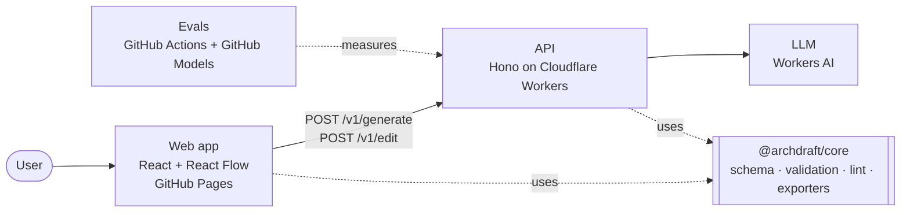

# Archdraft

Describe a cloud architecture in plain language and get an editable, reviewable diagram.

> **Status:** early development. The domain model is in place; the editor, the AI backend and the evaluation suite are being built in the order described in the [roadmap](docs/roadmap.md).

## What it does

1. **Draft**: write "a REST API on containers behind a load balancer, with a Postgres database and a queue for async jobs" and get a structured diagram, not a picture.
2. **Edit**: move, connect and configure components on a canvas, or ask for changes in natural language.
3. **Review**: a rule engine flags design risks as you edit: single points of failure, databases exposed to the internet, long synchronous call chains.
4. **Export**: Mermaid, draw.io, PNG/SVG or JSON. Share a diagram with a link; nothing is stored on a server.

Diagrams are provider-agnostic and can be rendered for AWS, Google Cloud or Azure. The editor is available in English and Spanish.

## Architecture



Everything runs on free tiers, with no credit card involved. The full design is in [docs/arquitectura.md](docs/arquitectura.md).

## Tech stack

| Area         | Choice                                                               |
| ------------ | -------------------------------------------------------------------- |
| Language     | TypeScript (strict) across the stack                                 |
| Domain model | Zod 4: types, runtime validation and JSON Schema from one definition |
| Frontend     | React, Vite, Tailwind CSS, React Flow, ELK.js                        |
| Backend      | Hono on Cloudflare Workers, Workers AI                               |
| Quality      | Vitest, Playwright, ESLint (type-aware), Prettier, GitHub Actions    |
| Hosting      | GitHub Pages (web), Cloudflare Workers (API)                         |

## Repository layout

```
apps/
  web/          # editor (planned)
  api/          # Cloudflare Worker (planned)
packages/
  core/         # domain model: schema, catalog, graph utilities, validation
  layout/       # automatic layout with ELK
evals/          # generation quality benchmark (planned)
docs/           # architecture, decisions (ADRs) and roadmap
```

## Getting started

Requirements: Node.js 22.12+ and pnpm 10.

```bash
pnpm install
pnpm check      # format, lint, typecheck, tests with coverage, build
```

| Script               | Purpose                         |
| -------------------- | ------------------------------- |
| `pnpm test`          | Run all unit tests              |
| `pnpm test:coverage` | Tests with coverage thresholds  |
| `pnpm lint`          | Type-aware ESLint               |
| `pnpm typecheck`     | `tsc --noEmit` in every package |
| `pnpm format`        | Format with Prettier            |

## Acknowledgements

The canvas is built on [React Flow](https://reactflow.dev) by xyflow (MIT licence) and laid out with [ELK](https://eclipse.dev/elk/) through elkjs. The editor hides React Flow's corner link, which its licence allows; this section is where the credit lives instead.

## Documentation

Design documentation lives in [`docs/`](docs/README.md) and is written in Spanish (see [ADR 0009](docs/adr/0009-idioma.md)). Code, commits and this README are in English.

- [Architecture](docs/arquitectura.md)
- [Domain model](docs/modelo-de-dominio.md)
- [Architecture decision records](docs/adr/)
- [Roadmap](docs/roadmap.md)

## License

[MIT](LICENSE)
