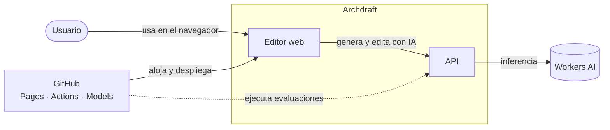
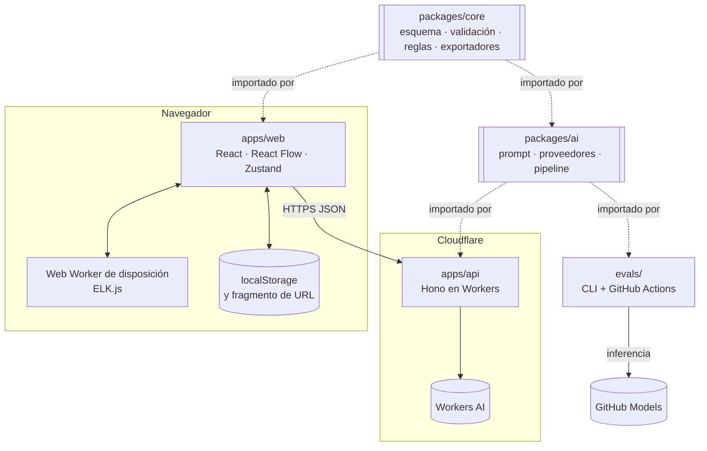
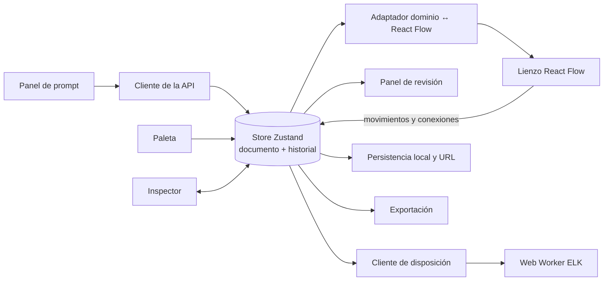
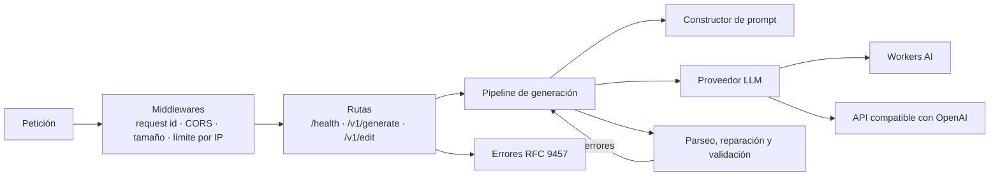
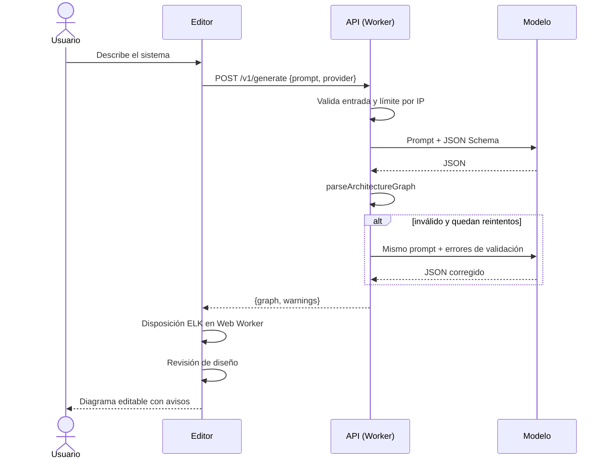
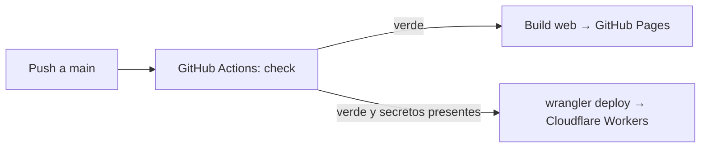

# Arquitectura

Este documento describe el sistema completo tal y como está diseñado para la versión 1.0. Cada sección indica qué partes existen ya y cuáles están planificadas, con la tarea del [roadmap](roadmap.md) que las implementa.

## 1. Restricciones que dan forma al diseño

| Restricción                            | Origen                      | Consecuencia en el diseño                                |
| -------------------------------------- | --------------------------- | -------------------------------------------------------- |
| Coste cero y sin tarjeta               | Requisito del proyecto      | GitHub Pages, Cloudflare Workers y Workers AI (ADR 0004) |
| Sin base de datos                      | Coste cero y privacidad     | El estado vive en el navegador; se comparte en la URL    |
| Cuota diaria de inferencia baja        | Plan gratuito de Workers AI | Límite de uso por IP; el editor funciona sin IA          |
| 10 ms de CPU por petición en el Worker | Plan gratuito de Workers    | Trabajo síncrono mínimo en la API; validación ligera     |
| Salida de un LLM no confiable          | Naturaleza del componente   | Toda respuesta se valida con el esquema antes de usarse  |

## 2. Contexto

El usuario solo interactúa con el editor. El editor es útil sin la API: se puede dibujar a mano, usar plantillas, revisar y exportar. La API añade la generación y la edición en lenguaje natural.

## 3. Contenedores

| Contenedor        | Responsabilidad                                                                                                            | Tecnología                                 | Despliegue                                               | Estado                                                                                              |
| ----------------- | -------------------------------------------------------------------------------------------------------------------------- | ------------------------------------------ | -------------------------------------------------------- | --------------------------------------------------------------------------------------------------- |
| `packages/core`   | Modelo de dominio: esquema, catálogo, índice del grafo, validación, reglas de diseño, exportadores, plantillas             | TypeScript puro, Zod                       | Librería interna                                         | Hecho (T01 a T06) salvo las operaciones de edición (T18)                                            |
| `packages/layout` | Disposición automática de un grafo jerárquico                                                                              | ELK.js                                     | Librería interna, ejecutada en un Web Worker             | Hecho (T04)                                                                                         |
| `packages/ai`     | Construcción del prompt, interfaz de proveedor LLM, proveedor compatible con OpenAI, pipeline de generación con reintentos | TypeScript puro                            | Librería interna, sin E/S propia salvo `fetch` inyectado | T14, T15, T18                                                                                       |
| `apps/web`        | Editor visual, revisión en vivo, exportación, persistencia local                                                           | React, Vite, Tailwind, React Flow, Zustand | GitHub Pages                                             | Estructura, despliegue, lienzo, edición y revisión hechos (T07 a T10); resto en T11, T12, T20 y T23 |
| `apps/api`        | Capa HTTP: rutas, validación de entrada, límites de uso, adaptador de Workers AI                                           | Hono, Cloudflare Workers, Workers AI       | Cloudflare Workers                                       | T13, T15, T18, T19                                                                                  |
| `evals/`          | Medir la calidad de la generación                                                                                          | TypeScript, GitHub Actions, GitHub Models  | Workflow de CI                                           | T16, T17                                                                                            |

La regla de dependencias es estricta: `apps/*` y `evals/` dependen de `packages/*`; `packages/*` nunca depende de `apps/*`. El pipeline de generación vive en `packages/ai` precisamente para que la API y el banco de evaluación ejecuten el mismo código: lo que se mide es lo que se despliega. Los paquetes no hacen E/S por su cuenta; reciben `fetch` o el proveedor por parámetro, así que se prueban sin red, sin navegador y sin Worker.

## 4. Componentes

### 4.1 packages/core

| Módulo           | Contenido                                                                                    | Estado |
| ---------------- | -------------------------------------------------------------------------------------------- | ------ |
| `kinds.ts`       | Vocabularios cerrados: proveedores, categorías, tipos de nodo, protocolos, modos             | Hecho  |
| `schema.ts`      | Esquema Zod del diagrama, límites, tipos derivados                                           | Hecho  |
| `catalog.ts`     | Definición de cada tipo de nodo, mapeo a productos, reglas de anidamiento                    | Hecho  |
| `graph.ts`       | Índice del grafo y recorridos (ancestros, descendientes), resolución de proveedor y producto | Hecho  |
| `validate.ts`    | Validación estructural y punto de entrada para datos no confiables                           | Hecho  |
| `json-schema.ts` | JSON Schema derivado para el LLM                                                             | Hecho  |
| `lint/`          | Motor de reglas de diseño                                                                    | Hecho  |
| `export/`        | Mermaid y JSON (T03), draw.io (T05)                                                          | Hecho  |
| `migrations.ts`  | Cadena de migraciones por `schemaVersion`, aplicada por `importJson`                         | Hecho  |
| `document.ts`    | Esquemas de `DiagramLayout` y `DiagramDocument`: grafo más posiciones y tamaños              | Hecho  |
| `templates/`     | Seis arquitecturas de referencia para la galería y el prompt                                 | Hecho  |
| `patch.ts`       | Operaciones de edición (añadir, quitar, modificar) y su aplicación                           | T18    |

Detalle en [modelo-de-dominio.md](modelo-de-dominio.md), [modulos/core.md](modulos/core.md), [modulos/lint.md](modulos/lint.md), [modulos/exportacion.md](modulos/exportacion.md), [modulos/plantillas.md](modulos/plantillas.md) y, para la disposición, [modulos/layout.md](modulos/layout.md).

### 4.2 apps/web

Hoy existen la estructura de la aplicación, el despliegue en Pages (T07), la interfaz centrada en el lienzo (T25, ADR 0014) y el lienzo React Flow con el adaptador `toFlow`, la disposición en un Web Worker y el zoom (T08), y la edición con el store de Zustand, el inspector y el historial (T09, ADR 0017, ver [modulos/web.md](modulos/web.md)). El panel de revisión de diseño llegó con T10. Faltan la persistencia, la exportación desde la interfaz y el cliente de la API. El diagrama muestra el diseño completo previsto:

Decisiones de diseño del editor:

- Un único documento en el store: `DiagramDocument` (`{ graph, layout: { positions, sizes } }`, esquema en `core`). El grafo es la fuente de verdad semántica; la disposición es presentación (ADR 0007). `computeLayout` de `packages/layout` calcula la disposición y, con posiciones fijadas, coloca solo los nodos nuevos.
- Toda modificación pasa por acciones del store que producen un nuevo documento inmutable, se validan con el esquema y `validateGraph` y se apilan en el historial para deshacer (ADR 0017). La disposición automática se calcula al abrir una plantilla; después, las posiciones son las que deja el usuario.
- React Flow es una vista: su estado de nodos y aristas se deriva del documento mediante un adaptador puro y testeable, y los cambios del lienzo vuelven al store como acciones.
- La revisión de diseño se recalcula en cada cambio. Las reglas son funciones puras y el grafo tiene como mucho 200 nodos, así que basta con memoizar por versión del documento.

### 4.3 apps/api y packages/ai (planificado)

- Hono como router por su tamaño mínimo y su soporte nativo de Workers.
- El constructor de prompt, el pipeline y el proveedor compatible con OpenAI están en `packages/ai`; en `apps/api` solo quedan las rutas, los middlewares y el adaptador del binding de Workers AI.
- El pipeline recibe el proveedor por inyección, de modo que los tests usan un proveedor falso y las evaluaciones uno real.
- El prompt incluye el catálogo de tipos, el JSON Schema del formato y ejemplos sacados de las plantillas.
- Si la salida no pasa la validación, se reintenta como máximo dos veces enviando al modelo los errores concretos. Es la técnica más barata para mejorar la tasa de salidas válidas con modelos pequeños.
- Los errores se devuelven como `application/problem+json` (RFC 9457) con un `type` estable que el frontend traduce a mensajes.

## 5. Flujos principales

### 5.1 Generar un diagrama

### 5.2 Editar con lenguaje natural

En lugar de regenerar el diagrama, el modelo devuelve una lista de operaciones (`addNode`, `removeNode`, `updateNode`, `addEdge`, `removeEdge`). El editor las aplica con `applyPatch` del núcleo y solo calcula posiciones para los nodos nuevos. Así se conserva la colocación manual y el usuario ve exactamente qué cambió (T18, T20).

### 5.3 Compartir

El documento se serializa, se comprime y se codifica en el fragmento de la URL (`#d=...`). El fragmento nunca se envía al servidor, de modo que compartir no expone el diagrama a ningún backend. Al abrir el enlace, el contenido pasa por `importJson` (migraciones y `parseArchitectureGraph`) como cualquier entrada no confiable (T11).

## 6. Formato de datos y versionado

- El formato está definido en `packages/core/src/schema.ts` y documentado en [modelo-de-dominio.md](modelo-de-dominio.md).
- `schemaVersion` es un entero. Un cambio incompatible incrementa la versión y añade una migración desde la anterior; `importJson` aplica la cadena al importar y rechaza versiones más nuevas que la del código.
- Las posiciones no forman parte del grafo semántico (ADR 0007).

## 7. Aspectos transversales

### Seguridad

- No hay secretos en el frontend. El modelo se invoca mediante binding dentro del Worker; los tokens de proveedores alternativos son secretos del Worker.
- CORS restringido al dominio del editor.
- Límites de tamaño en la entrada: prompt de 4.000 caracteres como máximo y cuerpo de 64 KB, más los límites del esquema (200 nodos, 400 aristas).
- La salida del modelo es dato, nunca código: se valida con esquemas estrictos y se renderiza como texto. Los exportadores escapan las etiquetas según el formato de destino (XML y HTML en draw.io, comillas y entidades en Mermaid).
- Límite de uso por IP para proteger la cuota diaria (T19).

### Privacidad

- No se almacenan diagramas ni prompts en servidor.
- Los logs de la API registran métricas (longitud, latencia, reintentos, resultado), no el contenido del prompt.

### Rendimiento

- ELK se carga de forma diferida y se ejecuta en un Web Worker.
- División del bundle por rutas y funcionalidades; presupuesto de tamaño verificado en CI (T22).

### Disponibilidad y degradación

- Si la API no responde o la cuota se agota, el editor lo indica y sigue funcionando en modo manual con plantillas.
- La API distingue cuota agotada (429 con `Retry-After`), error del modelo (502) y entrada inválida (400).

### Observabilidad

- Logs estructurados en JSON con identificador de petición, visibles en Workers Logs.
- Métricas de calidad de la generación en los informes del banco de evaluación.

## 8. Despliegue

Los pasos manuales necesarios (activar Pages, cuenta de Cloudflare, secretos) están en [operaciones.md](operaciones.md).

## 9. Riesgos técnicos

| Riesgo                                                     | Probabilidad | Impacto | Mitigación                                                                                          |
| ---------------------------------------------------------- | ------------ | ------- | --------------------------------------------------------------------------------------------------- |
| Los modelos gratuitos generan JSON inválido con frecuencia | Media        | Alto    | JSON Schema, reintentos con errores, few-shot, medición en evals                                    |
| El parseo y la validación superan 10 ms de CPU             | Baja         | Medio   | Medir en T19; si ocurre, validar en el cliente y dejar en el Worker solo la comprobación de esquema |
| La cuota diaria se agota                                   | Media        | Medio   | Límite por IP, proveedor alternativo, editor útil sin IA                                            |
| Cambios en los planes gratuitos                            | Media        | Alto    | Proveedores intercambiables, documentación de límites con fecha                                     |
| Diagramas grandes lentos en el lienzo                      | Baja         | Medio   | Límite de 200 nodos, memoización, disposición en worker                                             |
