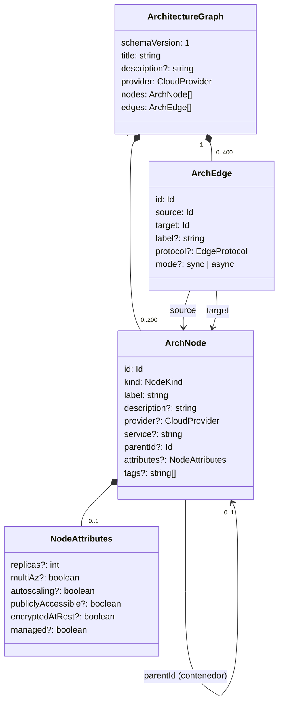

# Modelo de dominio

El modelo de dominio describe qué es un diagrama de arquitectura para Archdraft. Vive en `packages/core` y lo comparten el editor, la API y el banco de evaluación. Las decisiones de fondo están en ADR 0005 (modelo agnóstico) y ADR 0006 (Zod como fuente de verdad).

## Conceptos

- Grafo (`ArchitectureGraph`): el diagrama completo. Declara el proveedor por defecto.
- Nodo (`ArchNode`): un componente (servicio, base de datos, cola...), un contenedor (región, red, subred, zona, frontera lógica) o una figura genérica (caja, círculo, rombo, nota). Lo distingue su `kind`.
- Arista (`ArchEdge`): una interacción dirigida entre dos componentes. Va del que inicia la interacción al que la recibe: la API llama a la base de datos, la cola entrega mensajes al worker.
- Atributos (`NodeAttributes`): hechos operativos sobre los que razonan las reglas de diseño.

## Vocabularios cerrados

Definidos en `kinds.ts` como listas `as const`, de las que salen a la vez los tipos de TypeScript y los enumerados de Zod.

| Vocabulario | Valores                                                                                                              |
| ----------- | -------------------------------------------------------------------------------------------------------------------- |
| Proveedores | `generic`, `aws`, `gcp`, `azure`                                                                                     |
| Categorías  | `actor`, `edge`, `compute`, `data`, `messaging`, `security`, `observability`, `ai`, `external`, `shape`, `container` |
| Protocolos  | `https`, `http`, `grpc`, `websocket`, `sql`, `tcp`, `amqp`, `kafka`, `event`, `other`                                |
| Modos       | `sync`, `async`                                                                                                      |

### Tipos de nodo

| Categoría     | Tipos                                                                                                 |
| ------------- | ----------------------------------------------------------------------------------------------------- |
| actor         | `user`, `web-client`, `mobile-client`                                                                 |
| edge          | `dns`, `cdn`, `load-balancer`, `api-gateway`                                                          |
| compute       | `service`, `function`, `vm`, `kubernetes-cluster`, `batch-job`                                        |
| data          | `relational-db`, `nosql-db`, `cache`, `object-storage`, `search-index`, `data-warehouse`, `vector-db` |
| messaging     | `queue`, `topic`, `stream`, `event-bus`                                                               |
| security      | `waf`, `identity-provider`, `secrets-manager`                                                         |
| observability | `monitoring`                                                                                          |
| ai            | `llm`                                                                                                 |
| external      | `external-system`                                                                                     |
| shape         | `box`, `circle`, `diamond`, `note`                                                                    |
| container     | `region`, `availability-zone`, `network`, `subnet`, `boundary`                                        |

### Figuras genéricas

Las figuras (`SHAPE_KINDS`, `isShapeKind`) sirven para flujos sencillos y anotaciones que no son arquitectura: un paso, un inicio o un fin, una decisión, una nota. No tienen producto en ningún proveedor ni atributos operativos, se conectan como cualquier componente y pueden ir dentro de contenedores. Las reglas de diseño las ignoran (ver [reglas de diseño](modulos/lint.md)) y la tarjeta del diagrama las cuenta aparte. Cada una tiene su tamaño por defecto en `SHAPE_SIZES`; `defaultSizeOf(kind)` devuelve el de cualquier tipo.

## Catálogo

`catalog.ts` define para cada tipo una etiqueta, una descripción, un icono de Lucide (ADR 0008) y el producto habitual en cada proveedor. Ejemplo:

| Tipo            | AWS        | Google Cloud        | Azure                 |
| --------------- | ---------- | ------------------- | --------------------- |
| `relational-db` | Amazon RDS | Cloud SQL           | Azure SQL Database    |
| `function`      | AWS Lambda | Cloud Run functions | Azure Functions       |
| `queue`         | Amazon SQS | Cloud Tasks         | Azure Service Bus     |
| `network`       | Amazon VPC | VPC network         | Azure Virtual Network |

El mapeo es orientativo: sirve para etiquetas y exportaciones, nunca para validar. Hay tipos sin equivalente en algún proveedor (por ejemplo `search-index` en Google Cloud); en ese caso se muestra la etiqueta genérica. Los proveedores renombran servicios con cierta frecuencia, así que este mapeo hay que revisarlo periódicamente.

### Resolución del producto mostrado

`resolveServiceName(node, graph)` aplica este orden:

1. `node.service`, si el usuario o el modelo fijaron un producto concreto.
2. El producto del catálogo para el proveedor efectivo (`node.provider` o, si no hay, `graph.provider`).
3. La etiqueta genérica del tipo.

## Contenedores y anidamiento

Los contenedores agrupan nodos mediante `parentId`. No participan en aristas: una conexión siempre une dos componentes concretos, porque conectar con una VPC no dice qué recibe el tráfico.

Reglas de anidamiento entre contenedores (`CONTAINMENT_RULES`):

| Contenedor          | Puede estar en el nivel superior | Padres permitidos               |
| ------------------- | -------------------------------- | ------------------------------- |
| `region`            | sí                               | `boundary`                      |
| `network`           | sí                               | `region`, `boundary`            |
| `availability-zone` | no                               | `region`, `network`, `boundary` |
| `subnet`            | no                               | `network`, `availability-zone`  |
| `boundary`          | sí                               | cualquier contenedor            |

Los componentes pueden estar en el nivel superior o dentro de cualquier contenedor. `boundary` es deliberadamente flexible: representa un equipo, un dominio, una cuenta o una zona de confianza.

La zona de disponibilidad puede ir dentro de la red o directamente de la región porque los proveedores lo modelan distinto: en AWS una subred pertenece a una zona y a una VPC; en Google Cloud las subredes son regionales. Ambas formas de dibujarlo son válidas.

## Modo de las aristas

`mode` es opcional. Cuando falta, `resolveEdgeMode(edge)` lo deduce del protocolo: `amqp`, `kafka` y `event` implican `async`; cualquier otro protocolo, o ninguno, se lee como `sync`, porque una flecha sin anotar en un diagrama de arquitectura suele significar petición y respuesta. Las reglas de diseño, y más adelante los exportadores, usan siempre el modo efectivo.

## Atributos operativos

Todos son opcionales y la ausencia significa desconocido, no falso. Una regla de diseño que necesite un atributo debe tratar el valor ausente como desconocido; por ejemplo, no puede afirmar que una base de datos no tiene alta disponibilidad si `multiAz` no está informado, solo sugerir revisarlo.

| Atributo             | Significado                          | Usado por                            |
| -------------------- | ------------------------------------ | ------------------------------------ |
| `replicas`           | Número de instancias                 | `single-point-of-failure`            |
| `multiAz`            | Desplegado en varias zonas           | `database-single-az`                 |
| `autoscaling`        | Escala con la carga                  | `single-point-of-failure`            |
| `publiclyAccessible` | Accesible desde internet             | `public-database`                    |
| `encryptedAtRest`    | Datos cifrados en reposo             | `unencrypted-data`                   |
| `managed`            | Servicio gestionado por el proveedor | `single-point-of-failure` lo excluye |

## Límites

| Límite               | Valor                                      | Motivo                                              |
| -------------------- | ------------------------------------------ | --------------------------------------------------- |
| Nodos                | 200                                        | Legibilidad del diagrama y rendimiento del lienzo   |
| Aristas              | 400                                        | Ídem                                                |
| Identificador        | 64 caracteres, `[A-Za-z0-9][A-Za-z0-9_-]*` | Estable, legible, seguro en URLs y exportadores     |
| Etiqueta             | 80 caracteres                              | Cabe en un nodo                                     |
| Título               | 120 caracteres                             |                                                     |
| Descripción          | 500 caracteres                             | Limita el tamaño del prompt y del enlace compartido |
| Producto (`service`) | 60 caracteres                              |                                                     |
| Etiquetas (`tags`)   | 10 de 32 caracteres                        |                                                     |
| Réplicas             | 1 a 1000                                   |                                                     |

Las cadenas se recortan (`trim`) al validar; una etiqueta compuesta solo de espacios es inválida.

## Validación

Hay dos capas, ambas en `validate.ts`, precedidas al importar un fichero por el parseo del JSON y las migraciones (ver [exportación e importación](modulos/exportacion.md#importación)):

1. Esquema (Zod): tipos, enumerados, longitudes y objetos estrictos. Una propiedad desconocida es un error.
2. Estructura (`validateGraph`): lo que el esquema no puede expresar.

| Código                       | Severidad | Cuándo                                                                               |
| ---------------------------- | --------- | ------------------------------------------------------------------------------------ |
| `INVALID_JSON`               | error     | Al importar, el texto no es JSON (`importJson`)                                      |
| `UNSUPPORTED_SCHEMA_VERSION` | error     | Al importar, la versión es más nueva que la actual o no tiene migración              |
| `MIGRATION_FAILED`           | error     | Al importar, una migración falla                                                     |
| `SCHEMA`                     | error     | La entrada no cumple el esquema. Incluye `path`                                      |
| `EMPTY_LABEL`                | error     | Un nodo que no es una figura ni texto tiene el nombre vacío                          |
| `INVALID_ATTACHMENT`         | error     | `attachedTo` en algo que no es texto, o hacia un grupo, un texto o un id inexistente |
| `DUPLICATE_NODE_ID`          | error     | Dos nodos con el mismo id                                                            |
| `DUPLICATE_EDGE_ID`          | error     | Dos aristas con el mismo id                                                          |
| `EDGE_UNKNOWN_SOURCE`        | error     | El origen de una arista no existe                                                    |
| `EDGE_UNKNOWN_TARGET`        | error     | El destino de una arista no existe                                                   |
| `EDGE_SELF_LOOP`             | error     | Una arista une un nodo consigo mismo                                                 |
| `EDGE_ENDPOINT_IS_CONTAINER` | error     | Una arista toca un contenedor                                                        |
| `DUPLICATE_EDGE`             | aviso     | Misma conexión repetida (origen, destino y protocolo)                                |
| `PARENT_NOT_FOUND`           | error     | `parentId` apunta a un nodo inexistente                                              |
| `PARENT_NOT_CONTAINER`       | error     | `parentId` apunta a un componente                                                    |
| `PARENT_CYCLE`               | error     | Contenedores anidados en bucle; se informa una vez por ciclo                         |
| `INVALID_CONTAINMENT`        | error     | Anidamiento no permitido o contenedor que no puede ir en el nivel superior           |

`parseArchitectureGraph(input)` es el punto de entrada para datos no confiables ya convertidos en objeto, como las respuestas del modelo; los ficheros y enlaces pasan antes por `importJson`, que parsea el texto, aplica las migraciones y termina llamándola. La función aplica las dos capas, nunca lanza excepciones y devuelve el grafo con sus avisos o la lista completa de problemas. Devolver todos los problemas a la vez, y no solo el primero, es lo que permite reintentar la generación pasando al modelo una lista de errores concreta.

Validación estructural no es lo mismo que revisión de diseño. Un grafo válido puede ser una mala arquitectura; eso lo detecta el motor de reglas, documentado en [modulos/lint.md](modulos/lint.md).

## Índice del grafo

`indexGraph(graph)` construye en O(n + e) mapas de nodos y aristas por id, hijos por contenedor, aristas entrantes y salientes por nodo y la lista de raíces. Lo usan la validación y lo usarán las reglas, la disposición y los exportadores.

Es tolerante con grafos inválidos: con ids duplicados gana la primera aparición y las referencias colgantes se ignoran. Así se puede indexar un grafo para informar de sus errores sin que el índice falle antes.

`getAncestors` y `getDescendants` recorren la jerarquía de contenedores y terminan aunque haya ciclos.

## JSON Schema para el modelo

`architectureGraphJsonSchema()` genera el JSON Schema (draft 2020-12) en modo `input`, con las descripciones de los campos. Ocupa unos 3,5 KB serializado, un tamaño razonable para incluirlo en cada prompt.

## Separación entre semántica y presentación

El grafo no contiene posiciones, tamaños ni colores. Esa información vive en el documento del editor junto al grafo (ADR 0007). Ventajas:

- El modelo no tiene que inventar coordenadas, una tarea que hace mal.
- Una edición con IA no desplaza lo que el usuario colocó a mano.
- Las reglas y exportadores semánticos no dependen de la disposición.

La disposición tiene su propio esquema en `document.ts`: `DiagramLayout` guarda, por id de nodo, la posición de la esquina superior izquierda relativa al contenedor padre (`positions`) y el tamaño (`sizes`), con coordenadas finitas, tamaños positivos y como mucho `LIMITS.maxNodes` entradas en cada mapa. `DiagramDocument` une `{ graph, layout }` y es lo que el editor guarda y comparte. Una entrada de la disposición sin nodo correspondiente no invalida el documento: se ignora. Las entradas se leen con `layoutEntry(record, id)`, que solo devuelve propiedades propias: un id como `constructor` es válido y `record[id]` devolvería el miembro heredado de `Object.prototype`. La calcula `packages/layout` ([disposición automática](modulos/layout.md)).

## Versionado del formato

`schemaVersion` vale 1. Cualquier cambio incompatible (renombrar un campo, eliminar un tipo) incrementa la versión y añade una función de migración desde la anterior. Añadir un campo opcional o un tipo nuevo es compatible hacia atrás y no cambia la versión.

`importJson` aplica la cadena de migraciones (`MIGRATIONS` en `migrations.ts`) antes de validar: un fichero de la versión `n` pasa por las migraciones `n → n + 1` hasta la versión actual. Un fichero de una versión más nueva que la del código se rechaza con `UNSUPPORTED_SCHEMA_VERSION` en lugar de intentar leerlo. Hoy la cadena está vacía; su funcionamiento y cómo añadir una migración están en [exportación e importación](modulos/exportacion.md#migraciones).
